<div align="center">

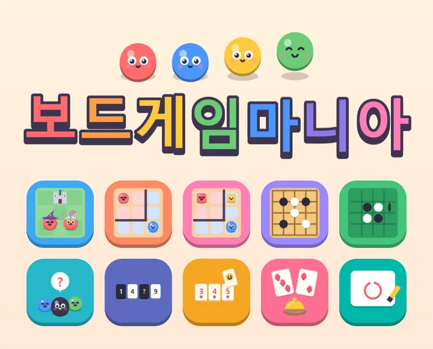

**Godot 4.7로 만든 캐주얼 모바일 보드게임 모음집**

게임 10개 · AI 대전 · 친구와 한 폰으로 · 온라인 대전 · 세로 화면

</div>

## 한눈에 보기

<table>
<tr>
<td width="260" align="center">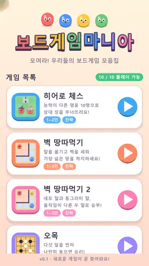</td>
<td valign="top">

| 항목 | 내용 |
|---|---|
| **게임** | 10개 (전략 · 클래식 · 추리 · 숫자 · 순발력 · 파티) |
| **인원** | 혼자부터 8명까지 |
| **AI** | 게임 8개에 쉬움 · 보통 · 어려움 |
| **온라인** | 히어로 체스 빠른 매칭 |
| **그림** | 게임 그림은 모두 코드로 그림 (이미지는 앱 아이콘뿐) |
| **엔진** | Godot 4.7 · GDScript · GL Compatibility |
| **설치** | Android 7.0 이상 · APK는 Godot에서 직접 내보냄 |

움직이는 화면은 모두 **실제 게임을 녹화**한 것입니다. 동그란 물결은 누른 자리이고, 보드게임은 AI끼리 두는 모습이에요.

</td>
</tr>
</table>

**바로 가기** — [게임 10개](#게임-10개) · [히어로 체스 자세히](#히어로-체스-자세히) · [온라인 대전](#온라인-대전-히어로-체스) · [발열 줄이기](#발열-줄이기) · [실행과 설치](#실행과-설치) · [폴더 구조](#폴더-구조) · [새 게임 추가하기](#새-게임-추가하기)

## 게임 10개

<table>
<tr>
<td width="250" align="center">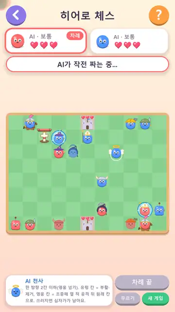</td>
<td valign="top">
<h3>히어로 체스</h3>
<sub>1~2인 · 온라인 · 전략</sub>
<p><b>능력이 다른 영웅 10명으로 상대 성의 하트 3개를 없애는 전략 게임</b></p>
<ul>
<li>차례마다 영웅 두 명이 <b>이동한 뒤 능력</b>을 씁니다</li>
<li>쓰러진 영웅은 유령이 되고 천사가 되살립니다</li>
<li>AI 3단계 · 친구와 2인 · <b>온라인 대전</b></li>
<li><a href="#히어로-체스-자세히">아래에서 자세히</a></li>
</ul>

</td>
</tr>
<tr>
<td width="250" align="center">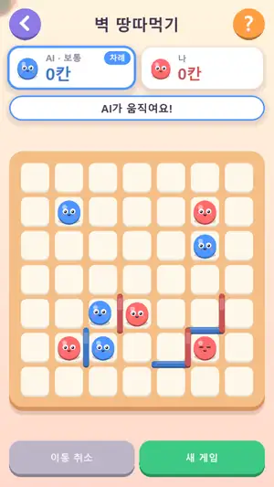</td>
<td valign="top">
<h3>벽 땅따먹기</h3>
<sub>1~3인 · 전략</sub>
<p><b>말을 옮기고 벽을 세워 가장 넓은 땅을 차지합니다</b></p>
<ul>
<li>말 하나를 2칸까지 옮기고(제자리도 됨) 선 칸의 한 변에 <b>꼭 벽</b>을 세웁니다</li>
<li>모두의 말이 벽으로 갈라지면 끝, 구역이 넓은 사람이 1등</li>
<li>서바이벌(3인전 → 1:1) · 3인전 · 1:1, 3인전은 벽 부수기 한 번</li>
<li>90초 제한 시간을 켤 수 있습니다</li>
</ul>

</td>
</tr>
<tr>
<td width="250" align="center">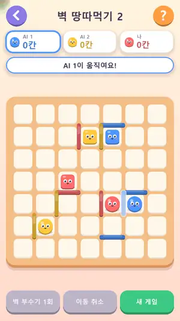</td>
<td valign="top">
<h3>벽 땅따먹기 2</h3>
<sub>1~3인 · 전략</sub>
<p><b>움직임이 다른 두 말로 겨루는 벽 땅따먹기</b></p>
<ul>
<li><b>네모 말</b>은 곧게 1~2칸</li>
<li><b>동그라미 말</b>은 1칸 간 뒤 꺾어서 1칸 더</li>
<li>나머지 규칙은 벽 땅따먹기와 같습니다</li>
</ul>

</td>
</tr>
<tr>
<td width="250" align="center">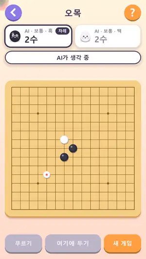</td>
<td valign="top">
<h3>오목</h3>
<sub>1~2인 · 클래식</sub>
<p><b>15×15 판에서 다섯 알을 먼저 나란히 놓으면 승리</b></p>
<ul>
<li>자유룰과 <b>쌍삼 금지</b> 중에서 고릅니다(금지 자리는 빨간 X)</li>
<li>미리보기 돌을 확인하고 두기, 무르기, 내 돌 색 고르기</li>
<li>AI가 연속 4 수순을 찾고, 어려움은 상대 응수까지 봅니다</li>
</ul>

</td>
</tr>
<tr>
<td width="250" align="center">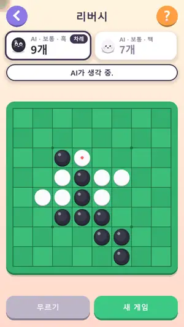</td>
<td valign="top">
<h3>리버시</h3>
<sub>1~2인 · 클래식</sub>
<p><b>상대 돌을 사이에 끼워 내 색으로 뒤집습니다(오셀로와 같은 규칙)</b></p>
<ul>
<li>둘 수 있는 곳 표시, 물결처럼 뒤집히는 애니메이션</li>
<li>둘 곳이 없으면 자동으로 차례가 넘어갑니다</li>
<li>AI는 빈칸 12개부터 끝까지 계산합니다</li>
</ul>

</td>
</tr>
<tr>
<td width="250" align="center">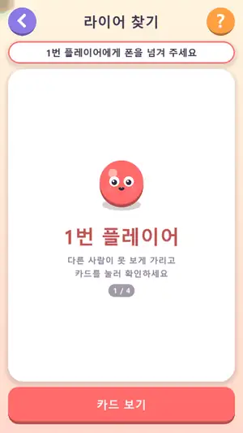</td>
<td valign="top">
<h3>라이어 찾기</h3>
<sub>3~8인 · 파티</sub>
<p><b>폰 하나를 돌려 가며 제시어를 모르는 라이어를 찾습니다</b></p>
<ul>
<li>시민은 제시어를, 라이어는 <b>정답 후보 20개</b>를 봅니다</li>
<li>설명 두 바퀴(순서대로 → 거꾸로) 뒤에 다 같이 지목</li>
<li>잡힌 라이어도 후보에서 제시어를 맞히면 역전승</li>
<li>주제 9가지, 바보 라이어, 설명 타이머, 점수판</li>
</ul>

</td>
</tr>
<tr>
<td width="250" align="center">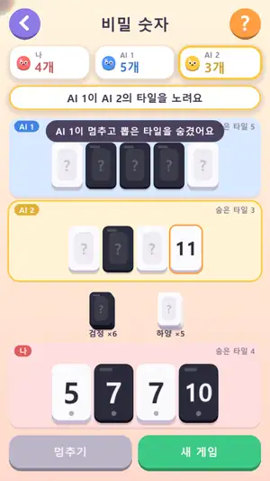</td>
<td valign="top">
<h3>비밀 숫자</h3>
<sub>1~4인 · 추리</sub>
<p><b>상대의 숨은 숫자 타일을 추리해서 맞힙니다(다빈치 코드와 같은 규칙, 조커 없음)</b></p>
<ul>
<li>0~11 검정 · 하양 타일, 작은 숫자부터 줄을 세웁니다</li>
<li>맞히면 한 번 더 도전하거나 멈추고 뽑은 타일을 숨깁니다</li>
<li>AI는 <b>가능한 숫자 배치를 모두 세어</b> 확률로 추리합니다</li>
</ul>

</td>
</tr>
<tr>
<td width="250" align="center">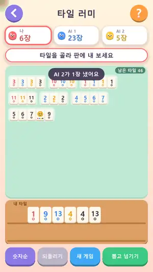</td>
<td valign="top">
<h3>타일 러미</h3>
<sub>1~4인 · 숫자</sub>
<p><b>숫자 타일로 묶음을 만들어 먼저 다 내면 승리(루미큐브와 같은 규칙)</b></p>
<ul>
<li>타일 106장(조커 2장), 처음 등록은 30점 이상</li>
<li>판의 묶음을 자유롭게 나누고 합칩니다</li>
<li>누르거나 끌어 놓아 옮기고, 틀린 묶음은 빨간색으로 표시</li>
</ul>

</td>
</tr>
<tr>
<td width="250" align="center">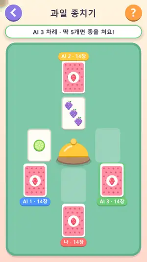</td>
<td valign="top">
<h3>과일 종치기</h3>
<sub>1~4인 · 순발력</sub>
<p><b>맨 위 카드에서 한 과일이 딱 5개가 되면 종을 칩니다(할리갈리 방식)</b></p>
<ul>
<li>맞히면 펼쳐진 카드를 모두 갖고, 틀리면 한 장씩 나눠 줍니다</li>
<li>AI 1~3명과 대결, 반응 속도 3단계</li>
<li>친구와 2인은 폰을 사이에 두고 <b>마주 보고</b> 합니다(여러 손가락 동시 터치)</li>
</ul>
<br>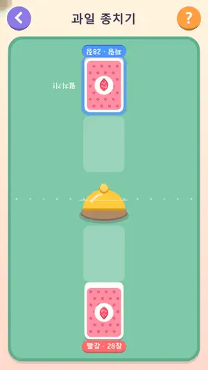
</td>
</tr>
<tr>
<td width="250" align="center">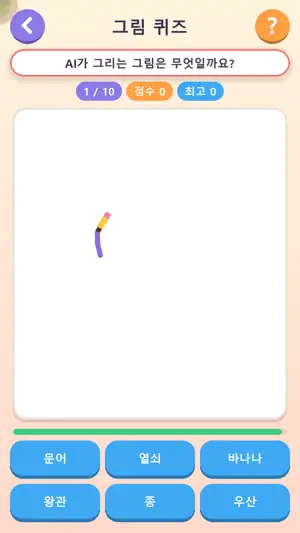</td>
<td valign="top">
<h3>그림 퀴즈</h3>
<sub>1~8인 · 파티</sub>
<p><b>그림을 그리고 맞힙니다(캐치마인드 방식)</b></p>
<ul>
<li><b>혼자</b>: AI가 그려 나가는 낙서 49가지를 6개 중에서 빨리 고르기, 10문제</li>
<li><b>친구들과</b>: 한 명이 그리고 나머지는 말로 맞히기, 2~8명</li>
<li>색 8가지 · 굵기 · 지우개 · 되돌리기, 주제 7가지</li>
</ul>
<br>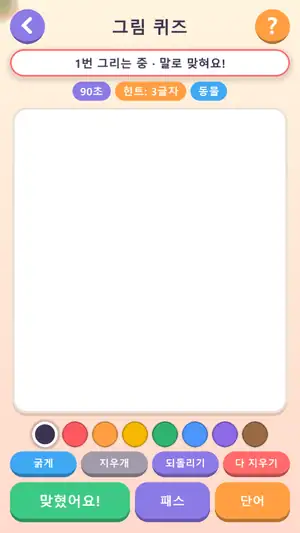
</td>
</tr>
</table>

## 히어로 체스 자세히

직접 만든 WinAPI 게임 [HeroChess](https://github.com/wighs33/HeroChess)에서 시작해 규칙을 새로 설계했습니다. 11×8 판에서 능력이 다른 영웅 10명으로 상대 성의 하트 3개를 먼저 없애면 이깁니다.

### 한 차례는 이렇게

<table>
<tr>
<td align="center" width="420">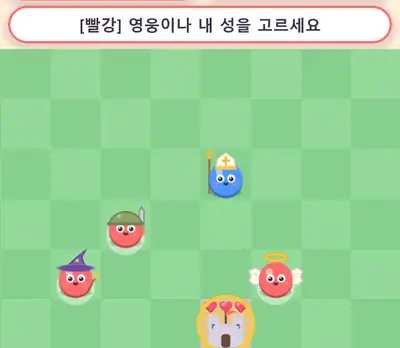</td>
<td valign="top">

1. **고르기** — 움직일 영웅을 누릅니다.
2. **이동** — 초록 점이 갈 수 있는 칸입니다. 제자리도 됩니다.
3. **능력** — 빨간 동그라미는 공격할 적, 노란 칸은 지뢰를 놓을 칸입니다.
4. **결과** — 쓰러진 영웅은 유령이 됩니다.

한 차례에 영웅 **두 명**이 행동합니다. 공격은 이동이 아니라 능력으로만 합니다.

</td>
</tr>
<tr>
<td align="center">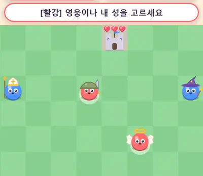</td>
<td valign="top">

**성 공격** — 로봇 · 건축가 · 닌자가 아닌 영웅은 상하좌우로 맞닿은 상대 성을 칠 수 있습니다. 하트 3개를 모두 없애면 승리합니다.

</td>
</tr>
<tr>
<td align="center">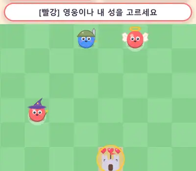</td>
<td valign="top">

**성 소환** — 행동 1개와 내 성 하트 1개로 내 영웅 한 명(로봇 제외)을 성 주위 5칸의 빈칸으로 불러옵니다. 하트가 2개 이상일 때만 됩니다.

</td>
</tr>
</table>

### 영웅 10명

<table>
<tr><th>영웅</th><th>이동과 능력</th><th>보기</th></tr>
<tr>
<td align="center" width="90">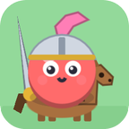<br><b>기사</b></td>
<td><b>이동</b> 말 탐: 한 방향 2칸 이하 · 말 없음: 1칸 (가로 · 세로)<br><br><b>능력</b> 이동 방향 바로 다음 칸의 적을 공격하거나 아군을 옮깁니다. 공격받으면 <b>말이 대신 죽고</b>, 내 성 주위 5칸으로 가면 말이 다시 생깁니다. 말을 탄 채 사신의 자동 공격이나 저주에 닿으면 1턴 동안 <b>흑기사</b>가 됩니다.</td>
<td align="center" width="300">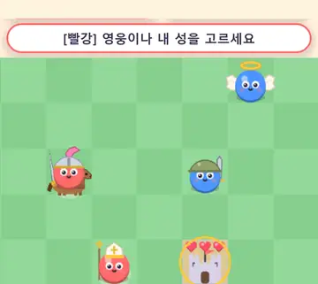</td>
</tr>
<tr>
<td align="center" width="90">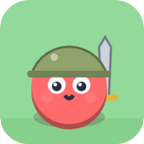<br><b>병사</b></td>
<td><b>이동</b> 2칸 이하, 자유롭게 (가로 · 세로)<br><br><b>능력</b> 상하좌우의 적을 공격하거나, 상하좌우 빈칸 모두에 <b>지뢰</b>를 놓습니다.</td>
<td align="center" width="300">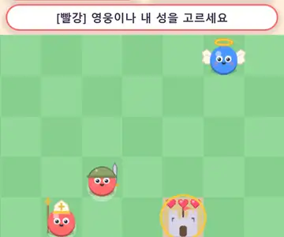</td>
</tr>
<tr>
<td align="center" width="90"><br><b>천사</b></td>
<td><b>이동</b> 한 방향 2칸 이하 (상하좌우) · 영웅을 넘거나 영웅 칸에 내려앉음<br><br><b>능력</b> 유령 칸이면 아군은 <b>부활</b>, 적은 제거. 영웅 칸이면 그 영웅(로봇 · 건축가 · 닌자 제외)을 <b>조종</b>해 상하좌우의 적을 공격하고 돌아옵니다. 쓰러지면 십자가를 남깁니다.</td>
<td align="center" width="300">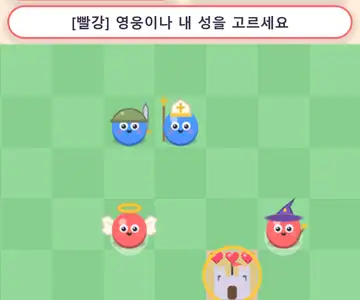<br>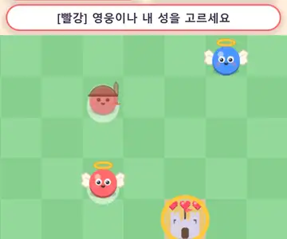</td>
</tr>
<tr>
<td align="center" width="90"><br><b>마법사</b></td>
<td><b>이동</b> 없음<br><br><b>능력</b> 상하좌우 3칸 <b>파이어볼</b>, 또는 아군(유령도)과 <b>자리를 바꾼 뒤</b> 주위 적 1명의 능력을 1턴 봉인합니다.</td>
<td align="center" width="300">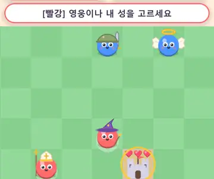<br>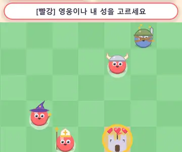</td>
</tr>
<tr>
<td align="center" width="90"><br><b>성직자</b></td>
<td><b>이동</b> 1칸 (가로 · 세로)<br><br><b>능력</b> 상하좌우의 아군이나 자신에게 <b>배리어</b>(한 편에 하나), 또는 상하좌우의 적 · 적 유령을 십자가로 공격. 내 성 주위 5칸에서 <b>희생</b>하면 천사가 십자가에서 부활합니다.</td>
<td align="center" width="300">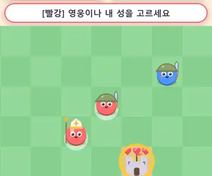<br>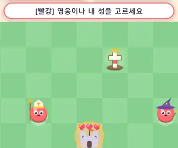</td>
</tr>
<tr>
<td align="center" width="90"><br><b>로봇</b></td>
<td><b>이동</b> 한 방향으로 자유롭게 (가로 · 세로)<br><br><b>능력</b> 움직인 방향 바로 앞의 적을 <b>밀고 스턴</b>, 한 칸 띄워진 영웅을 <b>끌어당기기</b>, 벽 · 포탑 부수기 중 하나. 성은 못 치고, 공격 · 무력 · 저주 · 조종의 대상이 되지 않습니다.</td>
<td align="center" width="300">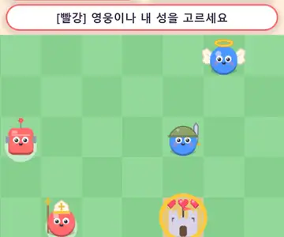<br>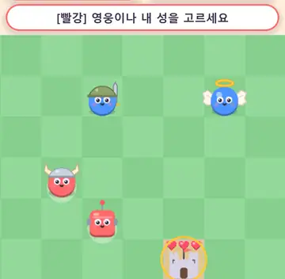</td>
</tr>
<tr>
<td align="center" width="90">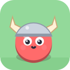<br><b>전사</b></td>
<td><b>이동</b> 1칸 (가로 · 세로)<br><br><b>능력</b> 주위 8칸의 적을 <b>무력</b>하게 만듭니다(이동 · 능력을 못 씀). 상하좌우의 적을 공격하거나 1칸 전진합니다.</td>
<td align="center" width="300">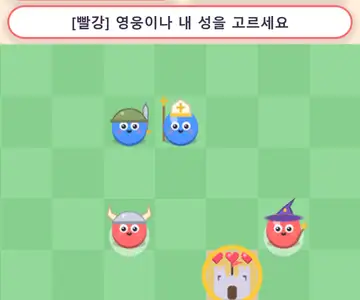</td>
</tr>
<tr>
<td align="center" width="90">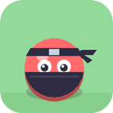<br><b>닌자</b></td>
<td><b>이동</b> 한 방향으로 자유롭게 (가로 · 세로) · 이동하면 능력을 못 씀<br><br><b>능력</b> 앞뒤 줄에서 마주 보는 영웅의 이동과 능력을 <b>따라 합니다</b>(상대 사신 · 닌자 제외). 다음 내 차례까지 그 모습입니다.</td>
<td align="center" width="300">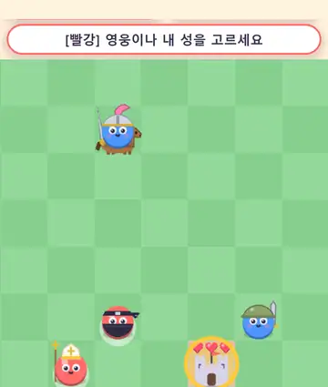</td>
</tr>
<tr>
<td align="center" width="90">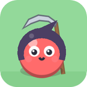<br><b>사신</b></td>
<td><b>이동</b> 1칸 (가로 · 세로), 벽을 통과<br><br><b>능력</b> 대각선 4칸의 적을 <b>자동 공격</b>. 상하좌우 2칸 안의 적이나 적 유령에게 <b>저주</b>를 걸고, 저주 걸린 적에게 날아가 흔적 없이 없앱니다.</td>
<td align="center" width="300">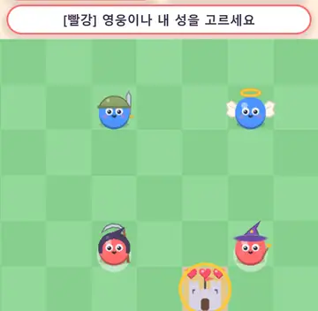</td>
</tr>
<tr>
<td align="center" width="90">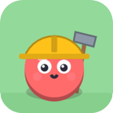<br><b>건축가</b></td>
<td><b>이동</b> 한 방향으로 자유롭게 (8방향) · 한 차례에 두 번 행동<br><br><b>능력</b> 자기 칸 네 변 중 하나에 <b>벽</b>을 세웁니다. 내 벽 네 개로 막은 칸은 주위 8칸을 자동 공격하는 <b>포탑</b>이 됩니다.</td>
<td align="center" width="300">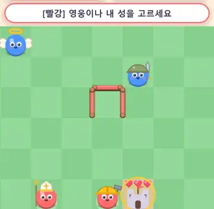</td>
</tr>
</table>

<sub>장면을 놓고 실제로 눌러서 찍었습니다. 사신 영상의 두 번째 행동은 다음 차례를 이어 붙인 것입니다.</sub>

### 판에서 보이는 표시

<table>
<tr><td align="center" valign="top" width="135"><br><b>배리어</b><br><sub>공격을 한 번 막음</sub></td><td align="center" valign="top" width="135"><br><b>유령</b><br><sub>쓰러진 영웅, 한 칸씩 움직임</sub></td><td align="center" valign="top" width="135"><br><b>십자가</b><br><sub>쓰러진 천사의 자리</sub></td><td align="center" valign="top" width="135"><br><b>저주</b><br><sub>사신이 그 자리로 와서 없앰</sub></td><td align="center" valign="top" width="135">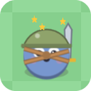<br><b>무력</b><br><sub>전사 주위, 이동과 능력 X</sub></td><td align="center" valign="top" width="135"><br><b>스턴</b><br><sub>1턴 동안 이동과 능력 X</sub></td></tr>
<tr><td align="center" valign="top" width="135">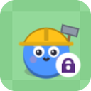<br><b>봉인</b><br><sub>1턴 동안 능력만 X</sub></td><td align="center" valign="top" width="135">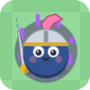<br><b>흑기사</b><br><sub>주위 8칸의 적 모두 공격</sub></td><td align="center" valign="top" width="135"><br><b>따라 하기</b><br><sub>다른 영웅 모습의 닌자</sub></td><td align="center" valign="top" width="135"><br><b>지뢰</b><br><sub>상대가 멈추면 터짐</sub></td><td align="center" valign="top" width="135">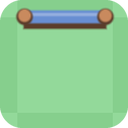<br><b>벽</b><br><sub>이동을, 적의 벽은 공격도 막음</sub></td><td align="center" valign="top" width="135">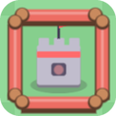<br><b>포탑</b><br><sub>주위 8칸 자동 공격</sub></td></tr>
</table>

<details>
<summary><b>공통 규칙 더 보기</b></summary>

| 규칙 | 내용 |
|---|---|
| 이동 | 빈칸에만 멈춥니다. 유령 칸과 십자가 칸은 지나갈 수만 있습니다. |
| 벽 | 이동을 막습니다(사신은 통과). 적군의 벽은 공격도 막지만 대각선 공격은 막지 못합니다. 로봇만 부술 수 있습니다. |
| 포탑 | 칸의 네 변을 아군 벽으로 막으면 생깁니다. 생길 때와 적이 주위 8칸에 멈출 때 공격합니다. 파이어볼과 저주를 막고, 로봇만 부술 수 있습니다. |
| 유령 | 상하좌우 빈칸으로 한 칸 움직입니다. 천사만 부활시키고, 성직자 · 천사 · 사신만 적 유령을 없앱니다. |
| 유령이 없는 경우 | 천사, 저주 이동으로 쓰러진 영웅, 포탑에 갇힌 영웅 |
| 십자가 | 천사가 쓰러진 칸에 생깁니다. 그 칸이 포탑이 되면 사라집니다. |
| 지뢰 | 상대 지뢰 칸에 멈추면 데미지를 받습니다. 적군 지뢰와 겹치면 지뢰끼리 터져 사라집니다. |
| 배치 | 맨 끝줄에서 시작하고, 시작 전에 영웅끼리 자리를 바꿀 수 있습니다. |
| 결전 | 80차례부터 20차례마다 두 성의 목숨이 1씩 줄어듭니다. 한쪽 영웅이 3명 이하이고 3명 이상 차이 나면 건너뜁니다. |

전체 규칙은 게임 안 **?** 버튼의 「게임 방법」에 있습니다.

</details>

## 온라인 대전 (히어로 체스)

<div align="center">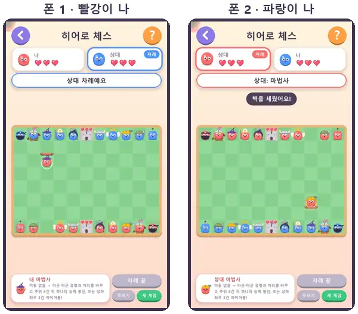</div>

두 폰이 같은 규칙 엔진으로 똑같이 계산하고, 내가 한 행동(누른 칸 목록)만 중계 서버를 거쳐 상대에게 보냅니다. 메시지마다 판 상태 지문을 붙여 두 폰의 계산이 달라지면 바로 알려 줍니다. 위쪽 자리인 사람에게는 판을 180° 돌려 **내 성이 늘 아래**에 보입니다.

두 기기에서 **온라인 대전**을 고르고 게임을 시작하면 빠른 매칭으로 이어집니다. 같은 규칙 버전끼리만 만납니다.

<details>
<summary><b>서버와 시험 방법</b></summary>

1. 중계 서버는 Render 무료 웹 서비스에 올라가 있습니다: `wss://boardgamemania-relay.onrender.com` (게임 기본값)
   - 서버 코드는 비공개 저장소 `wighs33/boardgamemania-relay`에 따로 있어요(작업 폴더의 `server/`, 이 저장소에는 없음). `main`에 푸시하면 Render가 자동으로 다시 배포해요.
   - 무료 서버는 15분 동안 접속이 없으면 잠들고, 다음 접속 때 깨어나는 데 1분쯤 걸려요 (앱은 75초까지 기다림).
   - 주소는 게임 화면에 보이지 않고, 브라우저로 열 수 있는 웹 페이지도 아니에요. 대전은 게임 안에서만 해요.
2. 다른 서버로 시험하려면 `games/herochess/hero_game.gd`의 `SERVER_URL`을 바꿉니다.
   - PC에서 직접 켜기 (`server/` 폴더가 있을 때):
     ```
     Godot_v4.7.2-stable_win64_console.exe --headless --path . -s res://server/relay_server.gd -- --port=8765
     ```
   - 같은 PC에서 시험: `ws://127.0.0.1:8765`
   - 같은 와이파이의 폰: `ws://<PC의 내부 IP>:8765` (윈도우 방화벽에서 8765 포트 허용 필요)
3. 폰 하나로 시험할 때는 PC에서 연습 상대 봇을 띄워 두세요:
   `… -s res://tests/online_bot.gd -- wss://boardgamemania-relay.onrender.com`
4. 서버 확인: `… -s res://tests/online_selftest.gd -- wss://boardgamemania-relay.onrender.com 3` (AI 둘이 3판, 두 쪽 상태 비교)
5. 규칙을 바꾸면 `games/herochess/hero_net.gd`의 `VER`를 올려 주세요. 같은 버전끼리만 매칭됩니다.

</details>

## 발열 줄이기

모든 그림을 코드로 그리다 보니 매 프레임 도형 수천 개를 새로 만들어 폰이 뜨거워졌습니다. 그림을 한 번 만들어 두고 바뀐 부분만 다시 그리게 바꿨습니다.

| 화면 | 전 | 후 |
|---|---|---|
| 과일 종치기 | 148% | **3%** |
| 히어로 체스 | 122~147% | **6~10%** |
| 메뉴 | 80% | **11%** |

<sub>PC에서 1초에 60프레임으로 돌릴 때의 CPU 부담 (코어 1개 = 100%). 폰의 온도를 잰 값은 아닙니다.</sub>

- 카드와 영웅 그림을 작은 화면에 한 번 그려 두고 재사용 (`fruit_atlas.gd`, `hero_sprites.gd`)
- 판을 층으로 나눠 바뀐 층만 다시 그림, 날개 · 깃발 같은 작은 흔들림은 5단계 그림을 돌려 씀
- 메뉴는 조각의 자리와 각도만 옮기고, 화면 밖 아이콘은 쉼
- 앱 전체를 1초에 60번으로 제한

## 실행과 설치

| 방법 | 하는 법 |
|---|---|
| **폰에 설치** | 아래 「안드로이드로 내보내기」로 APK를 만들어 폰으로 옮겨 설치 ("출처를 알 수 없는 앱" 허용) |
| **PC에서 실행** | Godot 4.7로 이 폴더의 `project.godot`를 열고 F5 |

<details>
<summary><b>테스트 돌리기</b></summary>

```
Godot_v4.7.2-stable_win64_console.exe --headless --path . -s res://tests/test_wall_logic.gd
Godot_v4.7.2-stable_win64_console.exe --headless --path . -s res://tests/test_omok_logic.gd
Godot_v4.7.2-stable_win64_console.exe --headless --path . -s res://tests/test_reversi_logic.gd
Godot_v4.7.2-stable_win64_console.exe --headless --path . -s res://tests/test_davinci_logic.gd   (비밀 숫자 + 라이어 찾기)
Godot_v4.7.2-stable_win64_console.exe --headless --path . -s res://tests/test_rummy_logic.gd
Godot_v4.7.2-stable_win64_console.exe --headless --path . -s res://tests/test_hero_logic.gd
Godot_v4.7.2-stable_win64_console.exe --headless --path . -s res://tests/test_fruit_logic.gd
Godot_v4.7.2-stable_win64_console.exe --headless --path . -s res://tests/test_drawquiz.gd
```

</details>

<details>
<summary><b>안드로이드로 내보내기</b></summary>

1. 에디터 메뉴 **편집기 → 내보내기 템플릿 관리**에서 템플릿 설치
2. **편집기 설정 → 내보내기 → Android**에 Android SDK 경로와 디버그 키스토어 지정
3. **프로젝트 → 내보내기 → 추가 → Android** 후 APK 내보내기 (또는 기기를 USB로 연결해 원클릭 배포)
4. 온라인 대전을 하려면 권한에서 **Internet**을 켭니다.
5. 지금 앱 위에 업데이트하려면 **같은 키**로 서명하고 버전 코드를 올립니다.

렌더러는 모바일 호환성이 좋은 `GL Compatibility`, 화면 방향은 세로로 설정되어 있습니다.
글꼴은 기기의 시스템 한글 글꼴을 씁니다. 더 귀여운 글꼴을 원하면 OFL 라이선스 글꼴(.ttf)을 `assets/fonts/`에 넣고 `UIKit.font()`를 바꾸면 됩니다.

</details>

## 폴더 구조

<table>
<tr>
<td width="240" align="center">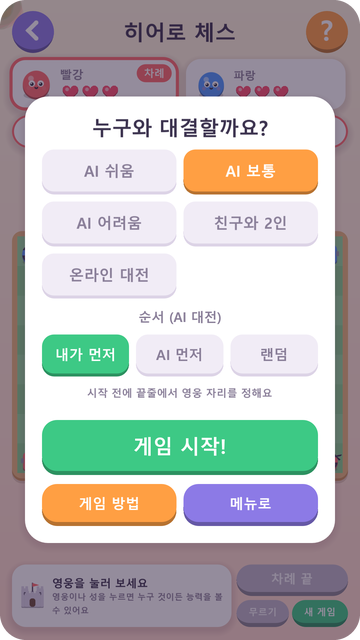</td>
<td valign="top">

모든 게임은 **같은 뼈대**(`GameScreen`) 위에서 돌아갑니다. 상단 바, 플레이어 카드, 설정 · 규칙 · 결과 팝업은 한 번만 만들었습니다.

게임마다 파일을 네 가지로 나눴습니다.

| 파일 | 하는 일 |
|---|---|
| `*_logic.gd` | 화면과 떨어진 규칙 엔진 (자동 테스트 대상) |
| `*_ai.gd` | 난이도 3단계 AI |
| `*_board.gd` 등 | 판 그리기와 터치 입력 |
| `*_game.gd` | 진행과 화면 (GameScreen 상속) |

</td>
</tr>
</table>

<details>
<summary><b>전체 파일 보기</b></summary>

```
scenes/main_menu.*        메인 메뉴 (게임 목록 허브)
scripts/global.gd         Autoload: 게임 목록, 저장, 화면 전환
scripts/game_screen.gd    모든 게임 화면의 공통 뼈대 (상단 바, 플레이어 카드, 설정/규칙/결과 팝업)
scripts/ui/               공용 UI (버튼/패널 UIKit, 말 그림 PieceArt · PieceNode, 게임 아이콘, 꽃가루 등)
games/wall/
  wall_logic.gd           규칙 엔진 (룰 1·2, 3인전/1:1, 벽 부수기)
  wall_ai.gd              AI (보로노이 영역 평가, 벽 부수기 아껴 쓰기, 어려움은 2수 앞)
  wall_board.gd           보드 그리기 + 터치 입력
  wall_game.gd            게임 화면 (GameScreen 상속, 서바이벌 라운드 진행)
  wall_game.tscn          룰 1 (rule = 1)
  wall2_game.tscn         룰 2 (rule = 2, 같은 스크립트)
games/omok/
  omok_logic.gd           규칙 엔진 (오목 판정, 쌍삼 판정, 무르기)
  omok_ai.gd              AI (공격/방어 점수, 연속 4 수순(VCF) 탐색, 어려움은 상대 응수까지)
  omok_board.gd           오목판 그리기 + 터치 입력
  omok_game.gd/.tscn      게임 화면 (GameScreen 상속)
games/reversi/
  reversi_logic.gd        규칙 엔진 (뒤집기, 패스, 종료, 무르기)
  reversi_ai.gd           AI (자리 가치 + 기동력 평가, 알파베타 탐색, 빈칸 12개 이하 끝내기 완전 계산)
  reversi_board.gd        판 그리기(물결 뒤집기 애니메이션) + 터치 입력
  reversi_game.gd/.tscn   게임 화면 (GameScreen 상속)
games/liar/
  liar_words.gd           주제별 제시어 목록 (주제 추가는 여기서)
  liar_logic.gd           역할 나누기, 지목, 라이어의 마지막 기회, 점수
  liar_game.gd/.tscn      진행 화면 (카드 확인 → 설명 → 지목 → 결과)
games/davinci/
  davinci_logic.gd        규칙 엔진 (뽑기, 맞히기, 멈추기, 탈락)
  davinci_ai.gd           AI (상대 줄마다 가능한 숫자 배치를 세어 확률 계산)
  davinci_board.gd        판 그리기(뒤집기 애니메이션, 말풍선) + 터치 입력
  davinci_game.gd/.tscn   게임 화면 (GameScreen 상속)
games/rummy/
  rummy_logic.gd          규칙 엔진 (묶음 판정 · 조커, 처음 등록, 확정 검사, 점수)
  rummy_ai.gd             AI (손패 묶음 최적 조합, 붙이기, 런 나누기, 빌려 오기)
  rummy_view.gd           판 + 받침대 그리기, 누르기/끌어 놓기/스크롤
  rummy_game.gd/.tscn     게임 화면 (GameScreen 상속)
games/herochess/
  hero_logic.gd           규칙 엔진 (배치, 영웅 10명의 이동 → 능력을 단계별로 진행, 지뢰 · 벽 · 유령 · 배리어 · 무력 · 밀기, 성 소환, 결전)
  hero_ai.gd              AI (첫 행동 후보 × 두 번째 행동 / 소환을 모두 평가, 어려움은 상대 첫 응수까지)
  hero_art.gd             영웅 · 성 · 지뢰 · 벽 · 하트 그림 (코드로 그린 캐주얼 스타일)
  hero_hearts.gd          플레이어 카드의 성 하트 줄
  hero_portrait.gd        정보 칸의 작은 초상화
  hero_board.gd           판 그리기(층을 나눠 바뀐 층만) + 터치 입력
  hero_fx.gd              영웅별 공격 효과(돌진 · 베기 · 빛기둥 · 별가루 · 십자 · 충격파 · 낫 · 유령 소용돌이 …)
  hero_sprites.gd         영웅 · 성 · 벽 · 지뢰 그림을 한 번 그려 두고 재사용 (발열 줄이기)
  hero_game.gd/.tscn      게임 화면 (GameScreen 상속, 배치 단계, 영웅 정보 칸, 소환 창, 온라인 대전)
  hero_net.gd             온라인 대전 메시지 (배치 · 행동 탭 목록 · 판 상태 지문, 버전 VER)
games/fruitbell/
  fruit_logic.gd          규칙 엔진 (카드 56장, 펼치기, 5개 판정, 종 치기 · 벌칙, 탈락)
  fruit_ai.gd             AI (난이도별 반응 속도 · 놓치기 · 헛치기, 펼치는 속도)
  fruit_art.gd            과일 4종 · 카드 앞뒤 · 종 그림
  fruit_atlas.gd          카드 21종을 화면 해상도에 맞춰 한 번만 그려 두는 그림 모음 (발열 줄이기)
  fruit_table.gd          탁자 그리기(펼치기 · 가져가기 애니메이션, 2인은 위쪽 자리 거꾸로) + 여러 손가락 터치, 층을 나눠 바뀐 층만 다시 그림
  fruit_game.gd/.tscn     게임 화면 (실시간 진행, 팝업이 열리면 멈춤)
games/drawquiz/
  quiz_words.gd           친구들과 할 때 그릴 단어 (주제 7가지)
  draw_doodles.gd         AI 낙서 그림 49가지 (100×100 좌표의 선 목록, 새 그림 추가는 여기서)
  draw_canvas.gd          손가락 그리기 도화지 + AI 낙서 그려 나가기
  draw_game.gd/.tscn      게임 화면 (친구들과: 가리개 → 제시어 → 그리기 → 누가 맞혔나 → 점수 / 혼자 맞히기)
scripts/online_client.gd  온라인 대전 클라이언트 (중계 서버 연결 · 빠른 매칭 · 메시지 주고받기)
docs/images/              README의 플레이 영상(WebP)과 그림
tests/                    규칙/AI 자동 테스트 (online_selftest.gd · online_bot.gd 는 온라인 대전 확인 도구)
```

</details>

## 새 게임 추가하기

1. `games/<게임id>/` 폴더를 만들고, 화면 스크립트는 `extends GameScreen`으로 시작합니다.
   - `_game_title()`, `_rules_text()`, `_start_game()`, `_is_game_over()` 등을 구현
   - `_ready()`에서 `build_frame()`을 부른 뒤 `content`에 보드와 버튼을 추가
   - 설정 선택지는 `_add_setup_options()`에서 `add_choice_row()`로 추가 (`columns`를 주면 여러 줄 격자)
   - 대전 방식 버튼은 `_mode_ids()`로 고르고(빈 배열이면 숨김), 이름은 `_mode_label()`로 바꿔요
   - 숨긴 패가 있는 게임을 친구끼리 할 때는 `show_curtain()`으로 다음 사람에게 폰을 넘기는 가리개를 띄워요
   - 끝나면 `record_result(승자)` → `show_standard_result(승자, rows)`
2. `scripts/global.gd`의 `games` 목록에 항목을 더하고 `scene` 경로를 넣은 뒤 `available`을 `true`로 둡니다.
